# UI review: app vs mockups (2026-11-05)

Build: `claude/tabbar-glass` @ `85f0ded` (main + #7 #8 #9 #10 #11 #12 #13), iPhone 17 Pro simulator, iOS 26, Dynamic Type **Large** (default), Vietnamese, launched with `-overviewSample YES -money.currency VND`. Spot checks in English and at Dynamic Type **AX Large**.

**Verdict:** the owner is right. Most screens are 20–60 % bigger than their mockup. Three things cause most of it, and they are shared code, not per-screen choices:

1. There are no type tokens. Each screen picks iOS text styles one size up from the mockup (17 pt where the mockup has 13–14 pt) and hard-codes 30–34 pt amounts.
2. There is no shared header or hero. Every tab builds its own "Moonee" title (22–34 pt; mockup 20 pt) and its own character frame (110–180 pt; mockup shows about 104 pt).
3. Component defaults (tab bar, chips, badges, buttons, jar row, chat card) are sized for 17 pt text.

Fix these once in S2's shared code; most screens then fall into line with small edits.

## How it was measured

- **Mockups:** 941×1672 px with a phone frame. The screen inside is 762 px wide (x 91–852), so **1.895 px per pt** horizontally (1.84 vertically: the mockup phone is a little squashed). Font size ≈ cap height (pt) ÷ 0.71, measured on unaccented capitals and digits. The mockups are generated images, so treat each value as **±1 pt**.
- **App:** sizes are taken from the code (exact). Spot measurements of the 3× screenshots agree; for example, `.title` measures 27.7 pt.
- **Paired images:** in `docs/ui-review/`, both sides are scaled to the same pt size (402 pt wide).
- **Severity:** **H** = broken or far off (content hidden or clipped, more than 40 % too big, accessibility failure). **M** = clearly off (20–40 %) or a missing element. **L** = polish.
- **Owners:** S2 shared tokens/components/tab bar · S5 Overview · S6 Budget · S4 Chat · S8 Watchlist · S7 Account and AI settings · S9 Local models.

### Proposed type scale (S2 adds these as tokens; screens use only these)

| Token | Mockup (measured) | Target | How |
|---|---|---|---|
| `screenTitle` ("Moonee") | 20–21 | **20 bold** | `.title3.bold()` |
| `headerPill` | 12.8 | **13 medium** | `.footnote.weight(.medium)` |
| `heroAmount` (budget total, net worth, wallet total) | 24–26 | **26 bold rounded** | `@ScaledMetric(relativeTo: .title)` so it follows Dynamic Type |
| `cardAmount` (spent today, card net worth) | 17–19 | **20 bold** | `.title3.bold()` (no change on Overview) |
| `greeting` ("Chào bạn!") | 16.6–18 | **17 bold** | `.headline.bold()` |
| `sectionTitle` | 14.3–16 | **16 semibold** | `.callout.weight(.semibold)` |
| `rowTitle` | 12.1–13.6 | **15 semibold** | `.subheadline.weight(.semibold)`. We deliberately go 1–2 pt above the mockup so text stays readable. |
| `body` (chat bubbles, notes) | 13.6 | **15** | `.subheadline` |
| `secondary` (row subtitles) | 9.8–12.8 | **13** | `.footnote` |
| `caption` (%, meta, tab labels) | 10.5–12 | **12** | `.caption` |
| `chip` | 11.3 | **13 medium** | `.footnote.weight(.medium)` |

### Proposed component sizes

| Component | Mockup | App now | Target |
|---|---|---|---|
| Header circle buttons | 36 | 44–48 | **36 visual, 44 hit area** (`.frame(width:44,height:44).contentShape(.circle)` around a 36 circle) |
| Hero character (visible height) | ≈104 (Overview, Chat, Account), ≈77 (Budget) | 135–138 visible in 150–180 frames | **104** / **76** compact |
| Tab bar height | 58–60 | 72 | **60** |
| (+) FAB | 51 | 66 | **56** |
| Card corner radius | ≈17 | 22 | **18** |
| Row icon badge | 31–36 | 38–44 | **34** |
| Pill segment / picker height | 32–33 | ≈41 | **36** |
| Quick-reply chip height | 35 | 43 | **36 visual, 44 hit area** |
| Outline pill ("Hoàn tác") | 24 | 35 | **30 visual, 44 hit area** |
| Chat input buttons / field | 35–37 / 39 | 48 / 48 | **40 / 40** |
| Primary button (`MooneeButtonStyle`) | n/a | 54 | **48** (vertical padding 16 → 13) |

---

## 1. Shared: tokens, components, tab bar (S2)

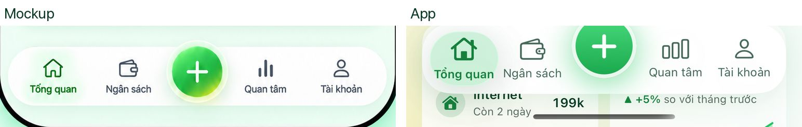

| # | Issue | Mockup vs app | Sev | File |
|---|---|---|---|---|
| S2-1 | No type tokens: screens use iOS styles one step too big | Body 13.6 vs 16–17, row titles 12–13.6 vs 17 (`.headline`), sections 15–16 vs 17–20. See the type scale above. | H | `Core/Theme.swift` (add `Font` tokens) |
| S2-2 | No shared screen header; every tab builds its own | "Moonee" 20 vs **28** (Overview `.title`), **28** rounded (Budget), **22** (Chat), **34** (Account `.largeTitle`); Watchlist uses a system large title instead. Pill 12.8 vs 13–15. Circle buttons 36 vs 44–48. | H | New `Core/Components/MooneeHeader.swift` (`subtitle`, optional leading and trailing button); screens adopt it |
| S2-3 | No shared hero; character frames differ, and the image's transparent padding makes the frame larger than what you see | Visible ≈104 vs 135–138 (Overview 180 frame, Account 150, Chat 180). Overview's hills end in a hard horizontal seam under the hero. | H | New `MooneeHero(mood:, compact:)` in `Components/MooneeCharacter.swift`, with `Hills` fading out at the bottom |
| S2-4 | Content scrolls under the floating tab bar: the last row can't be reached | At scroll end, Overview's last recent transaction, Budget's quick-action labels and Account's tiles stay behind the bar (`overview-scrolled.jpg`, `budget.jpg`). The `.safeAreaInset(edge: .bottom)` on the `TabView` doesn't reach each tab's `ScrollView`. | H | `App/MooneeApp.swift:47`: put the inset on each tab's content, or add `.contentMargins(.bottom, barHeight, for: .scrollContent)` |
| S2-5 | Fixed-size amounts ignore Dynamic Type and are too big | 24–26 vs **30–34 pt** `.system(size:)` in `JarsSection.swift:70,220`, `WalletsView.swift:29`, `BillsSection.swift:25`, `WatchlistView.swift:54` | H | Add a `heroAmount` token (S2); screen owners switch to it |
| S2-6 | Tab bar is oversized | Bar 72 vs 60, FAB 66 vs 51 (target 56). On the outer tabs the selected glass pill pokes past the bar's rounded end (Account tab, `account.jpg`). | M | `Components/MooneeTabBar.swift:26-44, 58-70` (inset the pill 4 pt; `minHeight` 60) |
| S2-7 | Tab bar at AX sizes truncates every label ("Tổng…", "Ngân…") | — | M | `MooneeTabBar.swift:55-56`: at `isAccessibilitySize` show icons only plus `.accessibilityShowsLargeContentViewer()` |
| S2-8 | Scrolled content runs under the status bar and Dynamic Island on screens with a hidden nav bar (text collides with the clock) | Overview, Budget, Account (`overview-scrolled.jpg`) | M | Shared modifier with an iOS 26 `.scrollEdgeEffectStyle(.soft, for: .top)` or a top material strip |
| S2-9 | `JarCard(.row)` is a 2-row, ~104 pt card; the mockup row is one 46 pt line | Mockup: icon 36 · name 13 / % 11 · bar + "3.250.000 đ / 5.500.000 đ" 10.5 · % chip 11 · chevron. App: name and amount `.headline` 17, short "5,85tr / 15,3tr". | H | `Components/JarCard.swift:115-146` |
| S2-10 | Chips and pills too big | `PercentChip` text 15 vs 11.3 (target 12 semibold); `PillPicker` vertical padding 10 (target height 36); `QuickReplyChip` 43 vs 35 | M | `JarCard.swift:69-86`, `Theme.swift:124-148`, `Chat.swift:179-210` |
| S2-11 | Chat components too big | Bubble `.callout` 16 vs 13.6 → 15; txn card title `.headline` 17 vs 12.8 → 15, subtitle 13 vs 10.5 → 12 and wraps to 2 lines, amount 17 vs 13.6 → 15, icon 40 → 34; saved banner text wraps; "Hoàn tác" 35 vs 24 tall; suggestion tile 122 vs 59 tall (3-line wrap, `.subheadline` + `.title2` icon); input buttons 48 vs 35–37 | H | `Components/Chat.swift:28, 81-101, 146-163, 200-207, 274-292` |
| S2-12 | Defaults a size too big | `card()` radius 22 → 18; `IconBadge` default 38 → 34; `MooneeButtonStyle` 54 → 48 tall; `OutlinePillStyle` (`Chat.swift:158`) is the only secondary style and lives in the chat file; move it to `Theme.swift` and size it 30 visual, 44 hit, so "Hoàn tác" and Bills "Đã trả" share it | L | `Theme.swift:94-98, 109-121, 152-163` |
| S2-13 | No rule for full vs short amounts, so screens differ | Mockups show full amounts in lists and cards ("199.000 đ", "3.250.000 đ / 5.500.000 đ"). App shows "199k", "2,5tr", "5,85tr / 15,3tr". Spec §B says to fix a rule for each place. | M | Proposed rule: short only in chart centres and tiles under 90 pt wide. Add it to `docs/FEATURES.md` §B; screens apply it. |

Checks against the spec's design notes:
- **Tabular figures:** pass. `AmountText` uses `monospacedDigit`, and every amount on these screens goes through it.
- **44 pt targets:** pass today, because the visuals are oversized. **Keep the hit area at 44 when shrinking visuals** (S2-2, S2-10, S2-11).
- **Dynamic Type:** fails. See S2-5, S2-7, B-1 and O-10 (`dynamic-type-ax-large.jpg`).
- **Reduce Motion:** mostly respected (character, tab bar). `PillPicker`, the Budget segments and the Chat scroll animate unconditionally (short animations, **L**).

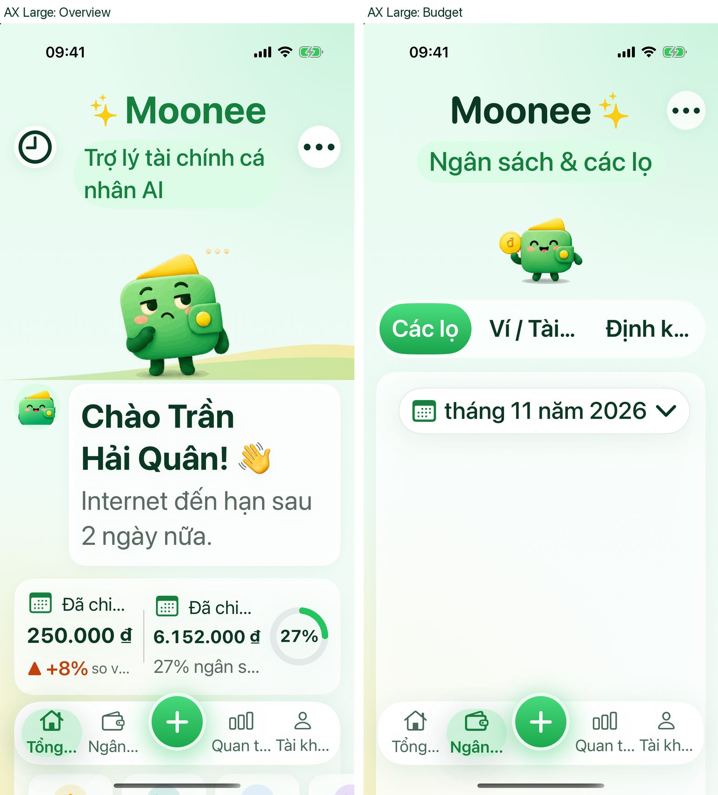

## 2. Overview (S5): `Features/Overview/OverviewView.swift`

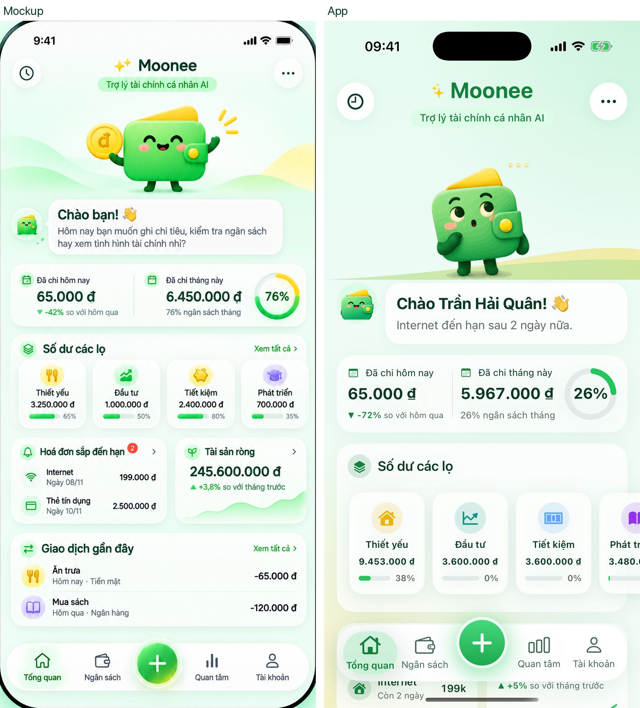
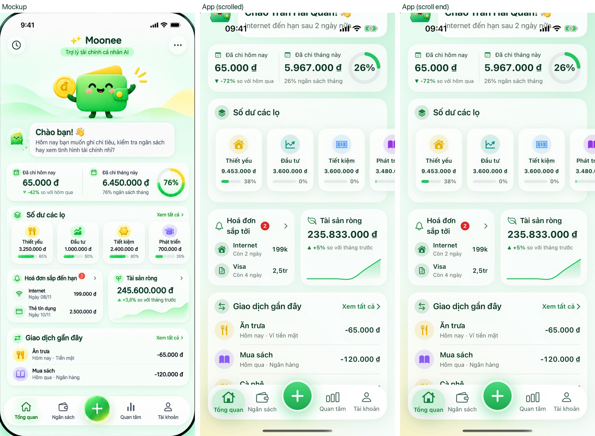

| # | Issue | Mockup vs app | Sev | Line |
|---|---|---|---|---|
| O-1 | Hero too big, and in the wrong mood | Visible ≈104 vs ≈138 (180 frame); "thinking" instead of "greeting" (known) | H | 92-95 (adopt `MooneeHero`) |
| O-2 | Header title and buttons | "Moonee" 20 vs 28; circle buttons 36 vs 48 | M | 60-87 (adopt `MooneeHeader`) |
| O-3 | Jar tiles don't fit; 4th is cut off | Mockup: 4 tiles ≈86×85 fit the card. App: fixed 96 wide in a horizontal scroll, ≈130 tall; name 15 vs 12.8, amount 15 bold vs 11.3 | M | 165-173 (4 equal columns with `maxWidth: .infinity`, no horizontal scroll for ≤4 jars) |
| O-4 | Jar section has no "Xem tất cả ›" | Present in mockup | L | 158-175 |
| O-5 | Bills card title wraps to 2 lines | "Hoá đơn sắp tới" 15 semibold with badge and chevron in half width vs one line ≈13 ("Hoá đơn sắp đến hạn") | M | 185 (`sectionTitle` token, `lineLimit(1)` + `minimumScaleFactor`) |
| O-6 | Bill amounts short | "199k" / "2,5tr" vs "199.000 đ" / "2.500.000 đ"; mockup has a date line "Ngày 08/11" where the app says "Còn 2 ngày" | M | 201-205 (rule S2-13) |
| O-7 | Greeting bubble too big | Title 20 vs 17–18; avatar 52 vs ≈41 | M | 97-101 |
| O-8 | Section titles | 17 vs 15–16 | L | 158 |
| O-9 | Recent rows | Badge 40 vs 31, title 15 vs 13.6 (OK after tokens) | L | 270-284 |
| O-10 | AX sizes: spent card labels truncate ("Đã chi…", "so v…") | `dynamic-type-ax-large.jpg` | M | 112-137 (stack the two halves when `isAccessibilitySize`, as the bills/net-worth pair already does) |

## 3. Budget (S6): `Features/Budget/*`, `Features/Wallets/WalletsView.swift`

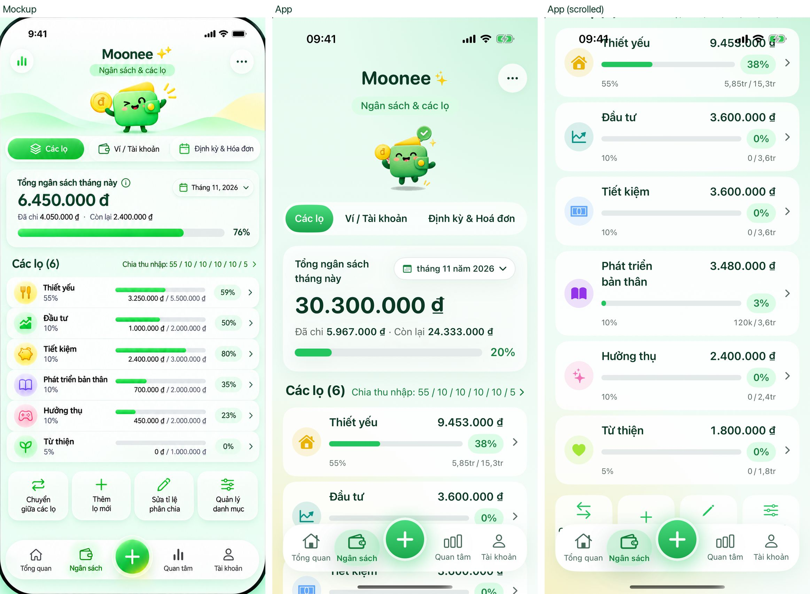
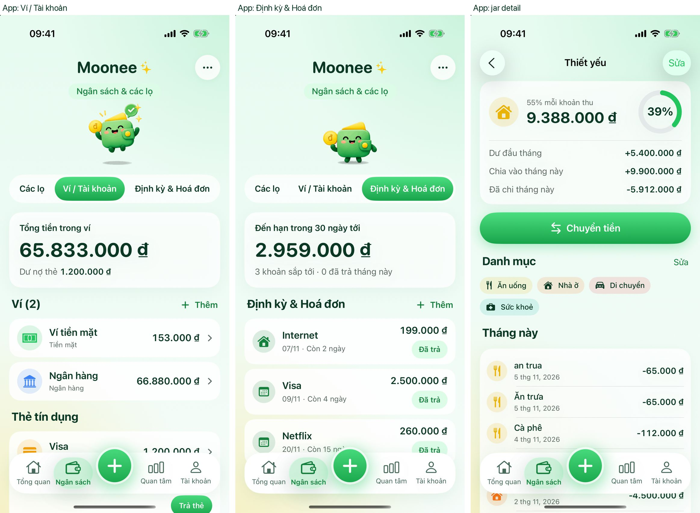

| # | Issue | Mockup vs app | Sev | File:line |
|---|---|---|---|---|
| B-1 | **Total card is blank at AX Large**: only the month picker shows; title, amount and bar disappear | `dynamic-type-ax-large.jpg` | H | `JarsSection.swift:60-85` |
| B-2 | Jar list layout | Mockup: one grouped card of 6 rows × 46 pt. App: 6 separate ≈104 pt cards (2 rows each). Needs S2-9 first, then put the rows in one card with dividers. | H | `JarsSection.swift:41` |
| B-3 | Total amount too big, fixed size | 25.6 vs 34 | H | `JarsSection.swift:70` (`heroAmount`) |
| B-4 | Header | Title 20 vs 28 rounded; pill 12.8 vs 15; mockup has a leading chart button, app has an empty spacer | M | `BudgetView.swift:44-71` (adopt `MooneeHeader`) |
| B-5 | Segments have no icons and are tall | Mockup icons (layers, wallet, calendar) at 33 pt high; the app falls back to text-only because the icon variant doesn't fit (`ViewThatFits`), pill ≈41 high. At AX the labels truncate ("Ví / Tài…"). | M | `BudgetView.swift:85-105` (shrink padding 14/11 → 10/7, `chip` font) |
| B-6 | "Tổng ngân sách tháng này" wraps to 2 lines; month chip reads "tháng 11 năm 2026" | Mockup: one line + "Tháng 11, 2026" | M | `JarsSection.swift:66, 92-102` (capitalised short month/year format; title `rowTitle` token) |
| B-7 | "Các lọ (6)" | 18 vs 20 | L | `BudgetView.swift:136` |
| B-8 | Wallets and bills summary amounts fixed 34 pt | 25–26 target | H | `WalletsView.swift:29`, `BillsSection.swift:25` |
| B-9 | Wallet and bill rows big | Name `.headline` 17, badge 44, amount `.headline` vs 15 / 34 / 15 | M | `WalletsView.swift:72-84, 102-109` |
| B-10 | Jar detail amount fixed 30 pt; "Chuyển tiền" 54 tall | 26 / 48 | M | `JarsSection.swift:220` |
| B-11 | "Đã trả" button reads like a status, not an action | Use "Đánh dấu đã trả" or a check icon + "Trả" | L | `Components/BillCard.swift:93-100` (copy is S6's) |
| B-12 | Hero frame 110 for a ≈74 visible character leaves a gap above the segments | Use `MooneeHero(compact:)` | L | `BudgetView.swift:69` |

## 4. Chat (S4): `Features/Chat/ChatView.swift` (component sizes are S2-11)

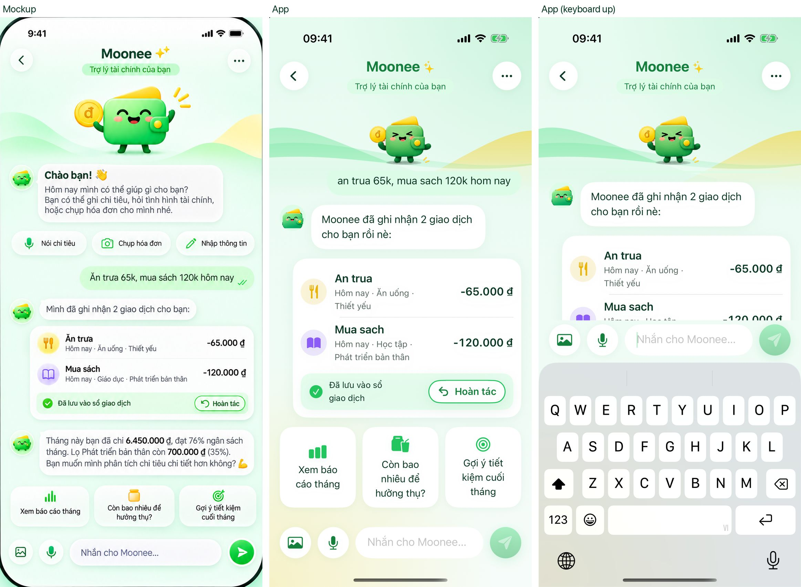
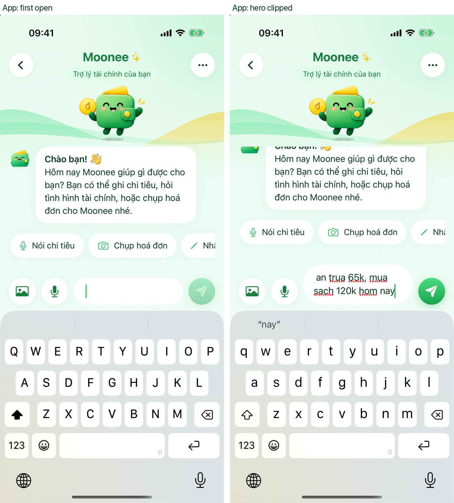

| # | Issue | Mockup vs app | Sev | Line |
|---|---|---|---|---|
| C-1 | Hero too big and gets clipped by the greeting bubble when the keyboard hides | ≈103 vs 180 (110 while focused); `chat-empty.jpg` shows the character cut off at the bubble | H | 120-131 (adopt `MooneeHero`; collapse to an avatar-sized hero or hide it while focused) |
| C-2 | Keyboard opens on every visit and can't be swiped away | Mockup opens with no keyboard and shows the chips; with the keyboard up, only ≈240 pt is left for messages | M | 57 (`focused = true` only when opened via (+) with intent; add `.scrollDismissesKeyboard(.interactively)`) |
| C-3 | Third quick-reply chip is cut off at the screen edge | Mockup fits all 3 | M | 150-156 (after S2-10 shrinks the chips they fit; otherwise wrap them) |
| C-4 | Header buttons 44 visual vs 36 | — | L | 95-140 (adopt `MooneeHeader`) |
| C-5 | User bubble has no "sent" double-tick | Mockup shows ✓✓ | L | bubble (S2 can add a `delivered` flag) |

## 5. Watchlist (S8): `Features/Watchlist/WatchlistView.swift`

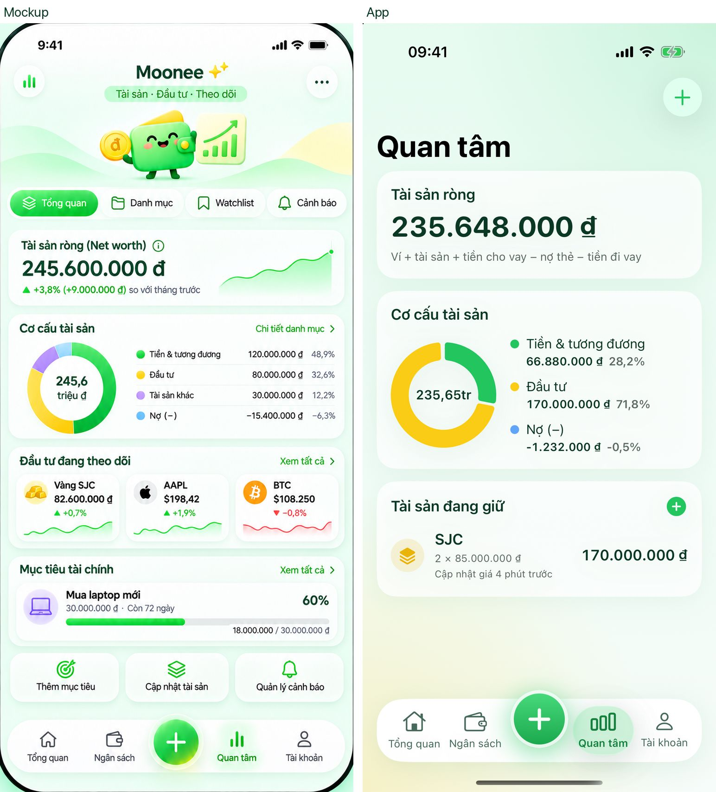

| # | Issue | Mockup vs app | Sev | Line |
|---|---|---|---|---|
| W-1 | System large title "Quan tâm" (34) instead of the Moonee header, pill "Tài sản · Đầu tư · Theo dõi" and hero | MVP skips the segments and live prices, but the header and hero are the brand frame of every tab | H | 31-32 (adopt `MooneeHeader` + `MooneeHero(compact:)`; keep "+" as the trailing button) |
| W-2 | Net-worth amount too big, fixed | 24 vs 32 rounded | H | 54 (`heroAmount`) |
| W-3 | Net-worth card is missing the change line and sparkline; it shows the formula text instead | Mockup: "▲ +3,8% (+9.000.000 đ) so với tháng trước" plus a sparkline. Overview already computes month-on-month (+5%). | M | 50-90 |
| W-4 | Composition legend wraps to 2 lines per item | Mockup: one row per item: dot · label · amount · % (≈10.5–11). App: label 15 then amount + % on a second line. | M | 115-134 |
| W-5 | Card titles `.headline` 17 vs 14.3; asset row `.body` 17 vs 15 | — | L | 52, 115, 159, 198, 215 |
| W-6 | Donut centre "235,65tr" vs "245,6 / triệu đ" on 2 lines at 15 | — | L | 118 |
| W-7 | No quick-action tile row ("Cập nhật tài sản") under the cards | MVP: only "Cập nhật tài sản" applies | L | — |

## 6. Account and AI settings (S7): `Features/Account/AccountView.swift`, `Security.swift`, `Features/AI/AISettingsView.swift`

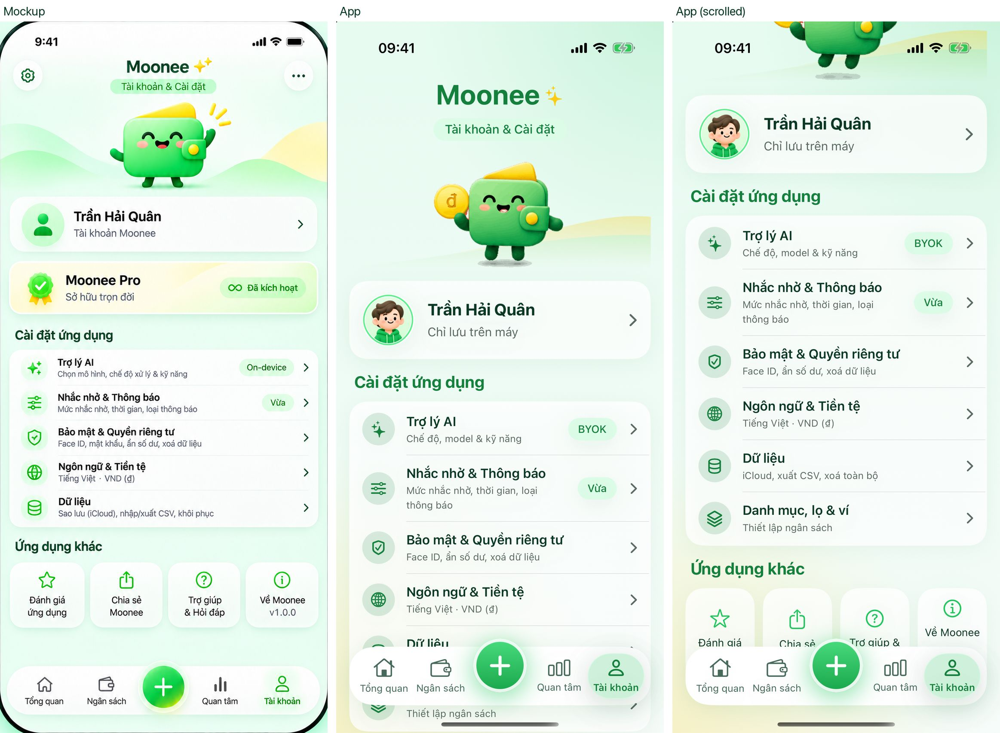
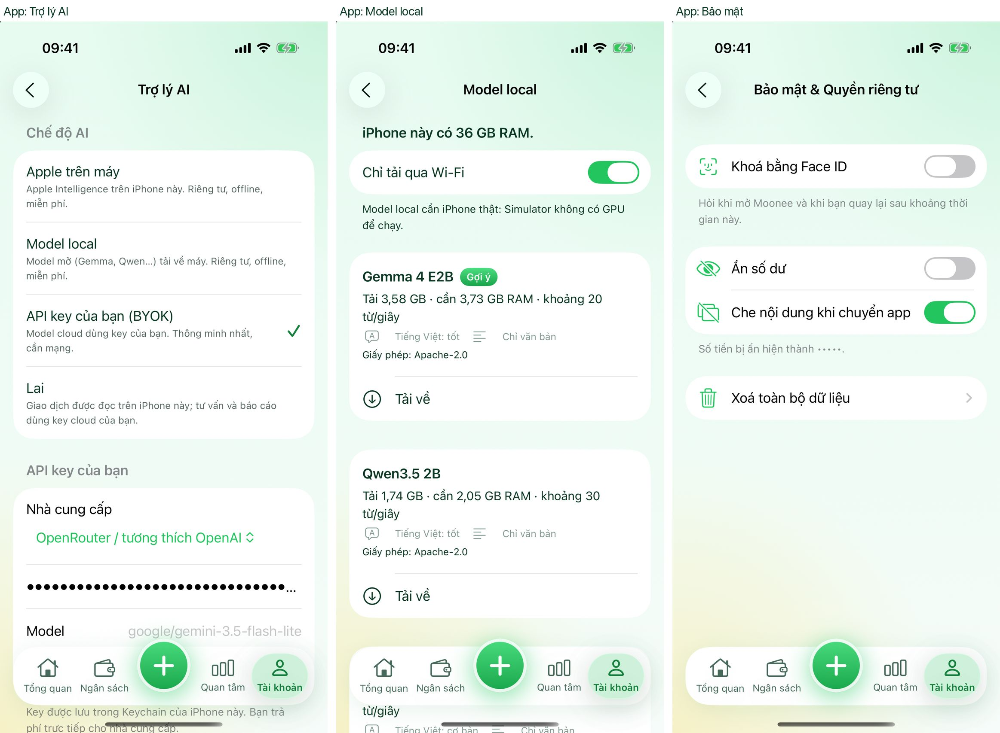
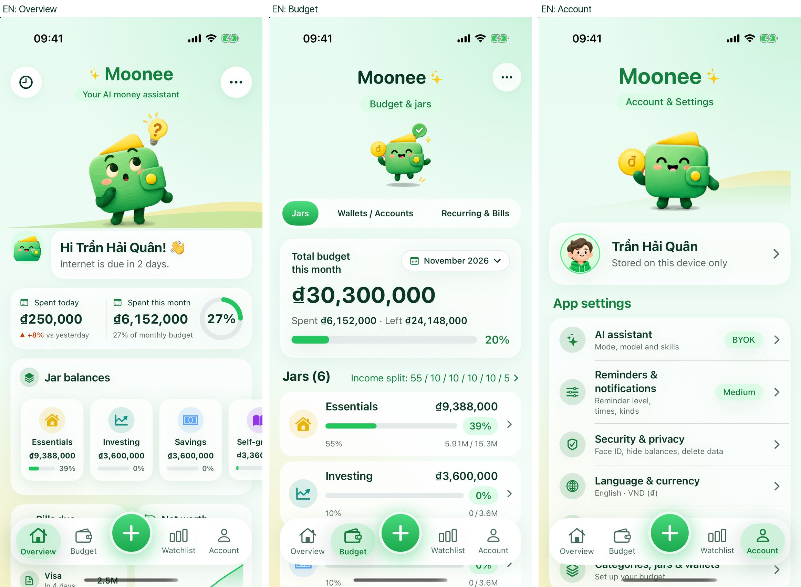

| # | Issue | Mockup vs app | Sev | Line |
|---|---|---|---|---|
| A-1 | Title `.largeTitle` 34 vs 20; no leading gear or trailing "…" buttons | — | H | `AccountView.swift:50-60` (adopt `MooneeHeader`) |
| A-2 | Hero too big | Visible ≈104 vs ≈135 (150 frame) | M | 63-65 |
| A-3 | Settings rows 65 tall vs 42 | Title `.callout` 16 vs 12.1 (target 15), subtitle 12 vs 9.8 (target 13 OK, one line), badge 40 → 34. Subtitles wrap in VI ("Mức nhắc nhở, thời gian, loại / thông báo") and the EN title wraps ("Reminders & / notifications"). | M | 112-130 |
| A-4 | Section titles green `.title3` 20 vs ink 15.8 | — | M | 91 |
| A-5 | Profile name `.title3` 20 vs 16.6 | — | L | 76-80 |
| A-6 | "Về Moonee" tile is laid out differently from its neighbours (label at top, version pinned to the bottom) | Centre like the others | L | 150-160 |
| A-7 | Destructive "Xoá toàn bộ dữ liệu" uses a green trash icon | Use `.danger` | L | `Security.swift:165` |
| A-8 | AI settings: provider menu drops below its label in the BYOK section | Inline value on the right, like the other rows | L | `AISettingsView.swift` |

## 7. Local models (S9): `Features/AI/LocalModelsView.swift`

| # | Issue | Mockup vs app | Sev | Line |
|---|---|---|---|---|
| L-1 | Hard-coded `.orange` / `.red` instead of `.warningText` / `.danger` tokens | Token rule in spec §A | M | 82, 113 |
| L-2 | Each model is its own List section, leaving ≈36 pt gaps; the cards feel heavy | Use one section with rows, or `.listSectionSpacing(.compact)` | L | whole list |
| L-3 | "Tải về" is a plain row; the app's action style is a green capsule | Use the S2 button style (small) | L | 93-120 |

(No mockup exists for this screen; reviewed against the design system only.)

---

## Not covered

- Profile setup onboarding (`Mint Moonee Profile Setup Onboarding.png`) is not built yet (S10).
- Data in the screenshots is the debug sample, so jar percentages and amounts differ from the mockup on purpose. Only sizes and layout were compared.
- VoiceOver labels were not exercised.
